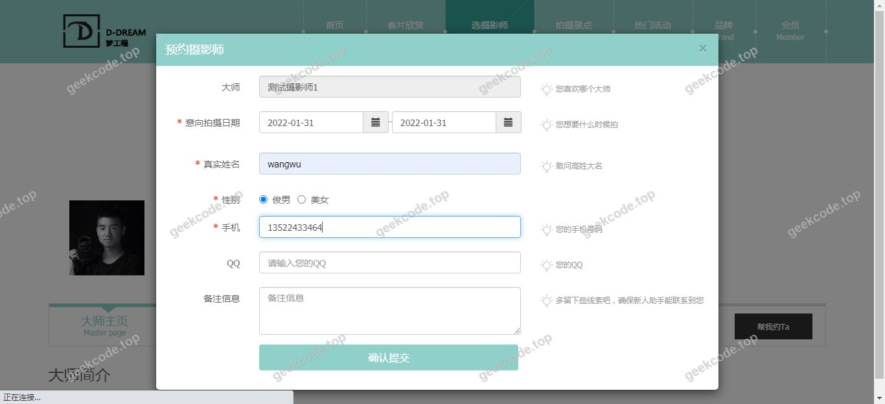
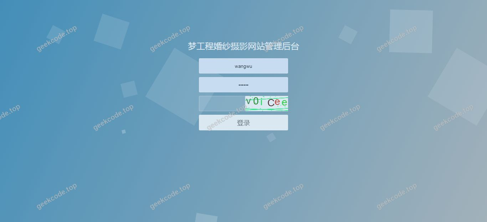
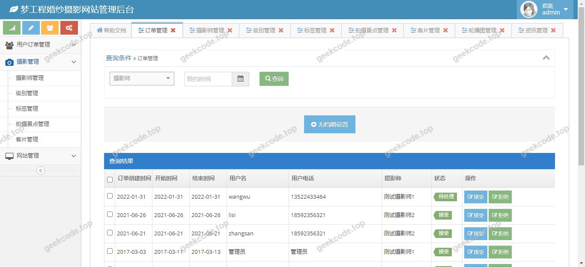
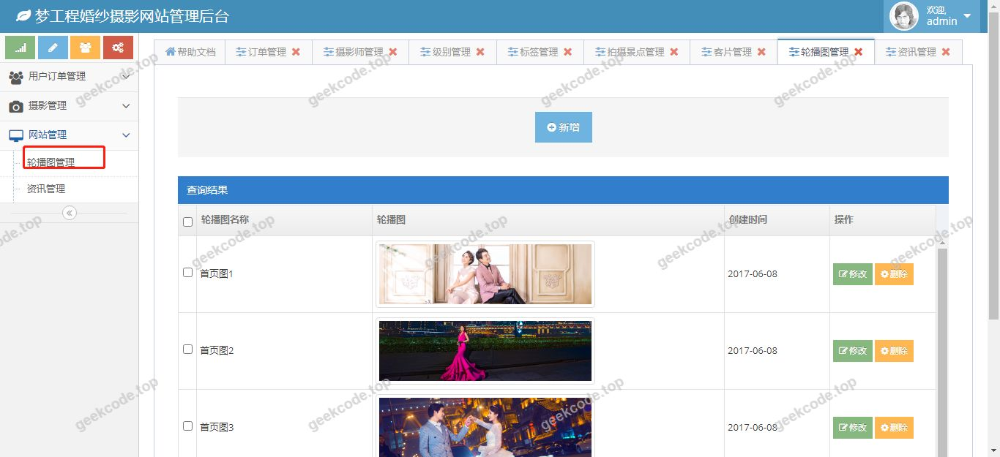

# Java精品项目-基于ssm的在线婚纱摄影预订系统

> 🎓 **计算机毕业设计 · Java精品项目-基于ssm的在线婚纱摄影预订系统**
>
> 本仓库只放**项目介绍 + 运行截图**（截图是站点带水印的原图，存在仓库 `images/` 里）。
>
> 👉 **完整可运行源码 / 数据库脚本 / 部署文档：[点我获取](https://geekcode.top/archives/Java%E7%B2%BE%E5%93%81%E9%A1%B9%E7%9B%AE-%E5%9F%BA%E4%BA%8Essm%E7%9A%84%E5%9C%A8%E7%BA%BF%E5%A9%9A%E7%BA%B1%E6%91%84%E5%BD%B1%E9%A2%84%E8%AE%A2%E7%B3%BB%E7%BB%9F?utm_source=github)**
>
> 💬 咨询微信：**ir9372**　|　🌐 更多项目：[极客代码 geekcode.top](https://geekcode.top/?utm_source=github)
>
> 📌 项目详情页：<https://geekcode.top/archives/Java%E7%B2%BE%E5%93%81%E9%A1%B9%E7%9B%AE-%E5%9F%BA%E4%BA%8Essm%E7%9A%84%E5%9C%A8%E7%BA%BF%E5%A9%9A%E7%BA%B1%E6%91%84%E5%BD%B1%E9%A2%84%E8%AE%A2%E7%B3%BB%E7%BB%9F?utm_source=github>

<table><td width="230" align="center"> <b>扫码加微信 ir9372</b></td><td valign="middle">📦 源码 = 项目介绍 + 全部运行截图 + 数据库 + 部署文档 👉 点上方任意截图，直接跳到 <b>极客代码 geekcode.top</b> 详情页</td></table>

---

<h1>Java精品项目-基于ssm的在线婚纱摄影预订系统</h1>
<h2>项目概述</h2>

本项目为“基于ssm的在线婚纱摄影预订系统”，旨在构建一个高效、稳定的Web应用平台，专门服务于婚纱摄影行业的业务管理需求。鉴于项目定位为后台管理系统（无前台用户端），其核心目标是实现婚纱摄影订单、套餐及服务内容的数字化管理与调度。系统主要面向婚纱摄影机构的内部管理人员，提供对业务数据的录入、查询、修改及状态监控功能。技术架构上，采用Spring Boot作为基础框架，整合MyBatis进行持久层操作，利用Druid数据库连接池优化性能，并通过Shiro组件保障系统的安全性与权限控制，前端视图渲染依赖Thymeleaf模板引擎，实现了后端逻辑与页面展示的清晰分离，确保了系统的可维护性与扩展性。

<h2>技术架构</h2>

本项目采用典型的Java Web分层架构设计，具体技术选型及理由如下：

<ol>
<li><strong>后端框架</strong>：选用 <strong>Spring Boot</strong> (版本未指定，但基于starter推断) 作为核心容器。通过 <code>spring-boot-starter-web</code> 快速搭建RESTful风格的服务接口，利用 <code>spring-boot-starter-aop</code> 实现日志记录或事务管理等横切关注点的解耦，<code>spring-boot-starter-jdbc</code> 提供基础的数据访问支持。</li>
<li><strong>持久层技术</strong>：集成 <strong>MyBatis</strong> (<code>mybatis-spring-boot-starter</code>) 作为ORM框架，配合 <code>mapper-spring-boot-starter</code> 简化通用CRUD操作的代码编写，提高开发效率。使用 <strong>MySQL</strong> (<code>mysql-connector-java</code>) 作为关系型数据库存储业务数据。</li>
<li><strong>连接池与安全</strong>：引入 <strong>Druid</strong> 作为数据库连接池，不仅提供高性能的连接复用，还具备强大的监控功能。安全方面采用 <strong>Apache Shiro</strong> 进行身份认证和授权管理，确保只有合法的管理员才能访问后台敏感功能。</li>
<li><strong>视图层</strong>：使用 <strong>Thymeleaf</strong> (<code>spring-boot-starter-thymeleaf</code>) 作为服务端模板引擎，负责生成HTML页面，实现前后端数据在服务器端的渲染交互，符合传统MVC模式的设计规范。</li>
<li><strong>测试与运行</strong>：包含 <code>spring-boot-starter-test</code> 用于单元测试，内嵌 <code>spring-boot-starter-tomcat</code> 作为Servlet容器，支持独立JAR包部署。</li>
</ol>
<h2>功能模块</h2>

根据项目“vue-integrated”类型标记及“是否有前台: 否”的配置，结合截图中的“系统运行界面”，本系统主要聚焦于后台管理功能。由于上下文未提供具体的后台路由列表，以下模块描述基于婚纱摄影预订系统的通用业务逻辑及现有信息推导的核心管理范畴：

<h3>后台管理端</h3>
<ul>
<li><strong>系统登录与鉴权</strong>：管理员账号密码登录，基于Shiro进行会话管理和权限校验。</li>
<li><strong>婚纱摄影套餐管理</strong>：对不同类型的婚纱摄影服务套餐（如室内、外景、旅拍等）进行增删改查，定义套餐价格、包含内容及时长。</li>
<li><strong>订单预订管理</strong>：查看和处理客户提交的拍摄预约请求，包括订单状态流转（待确认、已安排、已完成、取消等）、拍摄时间协调及摄影师分配。</li>
<li><strong>客户信息管理</strong>：记录并维护预订客户的联系方式、偏好信息及历史消费记录。</li>
<li><strong>基础数据配置</strong>：管理系统所需的字典数据，如拍摄地点库、服装道具库存信息等。</li>
</ul>

<em>(注：因上下文明确指出“无前台导航菜单”、“无个人中心菜单”且“是否有前台: 否”，故不存在面向普通消费者的公开浏览或自助下单模块，所有业务操作均需在后台由管理员执行。)</em>

<h2>用户角色与权限</h2>

基于Shiro框架及安全最佳实践，系统主要涉及单一核心角色：

<ul>
<li><strong>超级管理员/后台操作员</strong>：</li>
<li><strong>权限范围</strong>：拥有系统最高权限。</li>
<li><strong>可访问功能</strong>：</li>
</ul>
<ol>
<li>全量访问后台所有业务模块（套餐、订单、客户等）。</li>
<li>执行数据的创建、读取、更新和删除（CRUD）操作。</li>
<li>查看系统运行状态及Druid监控数据。</li>
<li>修改个人登录密码及基本账户信息。</li>
</ol>

<em>(说明：根据现有信息无法确定是否存在其他细分角色如“财务专员”或“客服主管”，因此默认所有后台操作均由具备完整权限的管理员角色完成。)</em>

<h2>项目特色与创新点</h2>
<ol>
<li><strong>安全性增强</strong>：集成 Apache Shiro 框架，实现了细粒度的权限控制和会话安全管理，有效防止未授权访问，保障婚纱摄影商业数据的安全性。</li>
<li><strong>高性能数据访问</strong>：采用 Druid 数据库连接池，相比传统连接池提供了更高效的资源复用机制，并内置了SQL监控功能，便于开发者实时排查慢查询和优化数据库性能。</li>
<li><strong>开发效率提升</strong>：通过 MyBatis Mapper 插件实现通用方法的自动化生成，减少了大量重复的DAO层代码编写，使开发人员能更专注于业务逻辑的实现。</li>
<li><strong>架构轻量化</strong>：基于 Spring Boot 的约定优于配置理念，去除了繁琐的XML配置文件，实现了项目的快速启动与部署，降低了运维复杂度。</li>
</ol>
<h2>部署环境</h2>

为确保系统正常运行，需准备以下软件环境：

<ul>
<li><strong>操作系统</strong>：Windows, Linux 或 macOS (建议64位)。</li>
<li><strong>JDK版本</strong>：Java Development Kit 8 或更高版本 (推荐 JDK 1.8)。</li>
<li><strong>数据库</strong>：MySQL Server 5.7 或 MySQL 8.0+。</li>
<li><strong>构建工具</strong>：Maven (用于依赖管理及项目打包)。</li>
<li><strong>浏览器</strong>：Chrome, Firefox, Edge 等现代主流浏览器 (用于访问后台管理界面)。</li>
<li><strong>IDE</strong>：IntelliJ IDEA 或 Eclipse (用于代码开发与调试)。</li>
</ul>

无需安装 Node.js 或微信开发者工具，因为该项目后端直接通过 Thymeleaf 渲染页面，不依赖独立的前端工程化构建流程。

<h2>五、技术特性</h2>
<ul>
<li>前后端集成部署，前端资源打包至后端 static 目录</li>
<li>集成 Shiro 权限框架实现角色权限控制</li>
</ul>
<h2>六、功能模块截图</h2>
<h3>前台用户端</h3>
<h4>系统运行界面1</h4>

<h4>系统运行界面2</h4>

<h4>系统运行界面3</h4>

<h4>系统运行界面4</h4>

<h4>系统运行界面5</h4>

<h4>系统运行界面6</h4>

<h4>系统运行界面7</h4>

<h4>系统运行界面8</h4>

---

## 获取完整源码

| 项目 | 说明 |
| --- | --- |
| 项目名 | Java精品项目-基于ssm的在线婚纱摄影预订系统 |
| 运行截图 | 本文 8 张（站点带水印原图，仓库 `images/` 目录） |
| 完整源码 | [https://geekcode.top/archives/Java%E7%B2%BE%E5%93%81%E9%A1%B9%E7%9B%AE-%E5%9F%BA%E4%BA%8Essm%E7%9A%84%E5%9C%A8%E7%BA%BF%E5%A9%9A%E7%BA%B1%E6%91%84%E5%BD%B1%E9%A2%84%E8%AE%A2%E7%B3%BB%E7%BB%9F?utm_source=github](https://geekcode.top/archives/Java%E7%B2%BE%E5%93%81%E9%A1%B9%E7%9B%AE-%E5%9F%BA%E4%BA%8Essm%E7%9A%84%E5%9C%A8%E7%BA%BF%E5%A9%9A%E7%BA%B1%E6%91%84%E5%BD%B1%E9%A2%84%E8%AE%A2%E7%B3%BB%E7%BB%9F?utm_source=github) |
| 咨询微信 | **ir9372**（备注：jingpin-yuanma） |
| 更多项目 | [极客代码 geekcode.top](https://geekcode.top/?utm_source=github) |

> 需要源码、部署、改配置、跑不起来等问题，加微信 ir9372 沟通，说明项目名即可。
